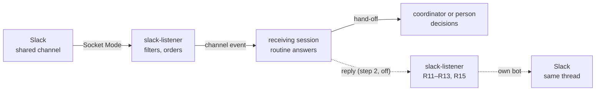

Magyarul: [specifikacio.md](../hu/specifikacio.md)

# slack-listener specification

This document summarises what slack-listener does and by which rules. The rules themselves are in [`RULES.md`](../../RULES.md): where this document differs from it, `RULES.md` is right.

## 1. What it is for, and for whom

Two sides share a Slack channel where their coordinating agents keep each other informed about work in flight. Most of its traffic is agent to agent, in both directions; a person typing is the exception.

The tool pushes each new message straight into a Claude Code session, so no session has to read the channel on a timer.

- **Each side runs its own instance,** with its own Slack app and its own receiving session. Nothing is tied to one side's setup.
- **The receiving session decides what to do.** A typical one answers factual, routine questions itself and passes the ones that need a real decision to the person or coordinator it works for. The model decides what to pass on, not the tool.

## 2. How a message reaches the session

- **Inbound:** the tool runs as a child process of the session, talks to it over MCP (stdio), and hands each message over as a `<channel source="slack-listener">` event. Each message carries its `channel`, `ts`, `thread_ts`, the author's id and name, and the time it was posted. A thread reply also carries a link and, when the thread was started by a configured person or bot of either side, typed or agent, that author and the first line of the parent; otherwise it says only that the thread was started by someone outside the configured people (R17). Every line of the quoted text starts with `> `, so no text can pass for the tool's own lines. A connection that brings no frame from Slack for 5 minutes is replaced, and the catch-up after it starts from the last frame received, so a laptop sleep or a silently dead connection loses nothing (R7). Slack sends nothing on a quiet channel that the tool can see, so a quiet channel reconnects about every 5 minutes; each reconnect costs one connection call, one history read and the replies of recently active threads.
- **Reaction:** once a message is handed to the session, the tool adds its own bot's `:eyes:` reaction to it (the emoji is `reaction` in the configuration), so the sender sees within seconds that it arrived. When the own side posts in that message's thread after it, or the session calls the `done` tool with the message's `ts` because it needs no reply, the tool trades `:eyes:` for `:heavy_check_mark:` (`handledReaction` in the configuration): it adds the check mark first, and when that call is given up the `:eyes:` stays, so a delivered message always carries one of the two; it shows none only if adding the `:eyes:` itself was given up. A `done` is saved before the session's call is answered, and the reaction queue after each call. A message already answered, or already marked done, when it is handed over gets the check mark at once. The two marks are a fixed pair: 👀 means received and not yet handled, ✔️ means handled, by a reply or a decision that none is needed. `done` takes the `ts` and nothing else, so no text of the session's reaches Slack, and it works only for a message this instance took in. The tool never touches anyone else's reaction, and a failing reaction call is tried three times and given up without holding up a delivery (R18).
- **Outbound, in step 2:** the session answers with the `reply` tool. The answer goes out as the side's own bot, in the right thread. This stays switched off until the conditions in `RULES.md` step 2 are met.

## 3. The rules in brief

The rule texts are in [`RULES.md`](../../RULES.md); this section only says when each one applies. The safety rules R2, R3, R4, R5, R10 and R17 and the backoff cap of R8 are checked by the simulator after every step, and R7, R8 and R18 at the end of every run, with R18's calls also checked as they are made; the simulator also checks R20–R22 as the malformed input arrives and at the end of every run; R6 and R11–R13 have unit tests, R19–R22 unit and shell tests with malformed input of each kind, and R15 has none yet. R19's simulator check comes with step 5a's disk faults. Rule ids appear in the test names. An id is never reused; a replaced or removed rule stays in place, marked.

| Rule | Applies  | About                                                                                                                                                                                                                                                                                                                                                                                                                                                                                                                                                                              |
| ---- | -------- | ---------------------------------------------------------------------------------------------------------------------------------------------------------------------------------------------------------------------------------------------------------------------------------------------------------------------------------------------------------------------------------------------------------------------------------------------------------------------------------------------------------------------------------------------------------------------------------- |
| R1   | replaced | replaced by R10                                                                                                                                                                                                                                                                                                                                                                                                                                                                                                                                                                    |
| R2   | step 1   | delivered at most once                                                                                                                                                                                                                                                                                                                                                                                                                                                                                                                                                             |
| R3   | step 1   | text is data, never an instruction                                                                                                                                                                                                                                                                                                                                                                                                                                                                                                                                                 |
| R4   | step 1   | order within a thread and at the top level; a message whose live event did not decode and that a later catch-up finds may come after newer ones                                                                                                                                                                                                                                                                                                                                                                                                                                    |
| R5   | step 1   | noise is not delivered                                                                                                                                                                                                                                                                                                                                                                                                                                                                                                                                                             |
| R6   | step 1   | tokens stay secret                                                                                                                                                                                                                                                                                                                                                                                                                                                                                                                                                                 |
| R7   | step 1   | every allowed message arrives, including those sent during an outage; after a disconnect, live messages wait until the next catch-up ends, and what a catch-up gathered survives the disconnect                                                                                                                                                                                                                                                                                                                                                                                    |
| R8   | step 1   | the instance reconnects                                                                                                                                                                                                                                                                                                                                                                                                                                                                                                                                                            |
| R9   | replaced | replaced by R16: it quoted the parent whoever wrote it                                                                                                                                                                                                                                                                                                                                                                                                                                                                                                                             |
| R10  | step 1   | the other side is heard, our own agents are not                                                                                                                                                                                                                                                                                                                                                                                                                                                                                                                                    |
| R16  | replaced | replaced by R17: an own-side agent who started a thread showed as an outsider                                                                                                                                                                                                                                                                                                                                                                                                                                                                                                      |
| R17  | step 1   | a thread reply can be answered on its own; the parent is quoted when any configured author wrote it                                                                                                                                                                                                                                                                                                                                                                                                                                                                                |
| R18  | step 1   | a reaction says the message reached the session; it turns into a check mark when our side answers after it or marks it done; when adding the check mark is given up, the reaction stays                                                                                                                                                                                                                                                                                                                                                                                            |
| R19  | step 1   | a state file that does not decode stops the tool before it connects                                                                                                                                                                                                                                                                                                                                                                                                                                                                                                                |
| R20  | step 1   | a Socket Mode frame that does not decode is dropped, and acknowledged when it has an id; a message in it is not delivered unless a catch-up within about 10 minutes reads it from history in a shape that decodes                                                                                                                                                                                                                                                                                                                                                                  |
| R21  | step 1   | a Web API answer that does not decode is a failed call, tried again like one; one message in a catch-up page that does not decode is skipped and logged, and the rest of the page is read; a thread parent that does not decode still has its replies read when its ts, reply_count and latest_reply decode, otherwise replies posted in its thread while the listener was away are not delivered unless also sent to the channel; a message that decodes live but not in a catch-up's history is skipped there, and a resend of its live event is dropped, so it is not delivered |
| R22  | step 1   | a session line that does not decode gets the JSON-RPC error, and the tool reads on                                                                                                                                                                                                                                                                                                                                                                                                                                                                                                 |
| R11  | step 2   | a post says who wrote it                                                                                                                                                                                                                                                                                                                                                                                                                                                                                                                                                           |
| R12  | step 2   | agent loops stop                                                                                                                                                                                                                                                                                                                                                                                                                                                                                                                                                                   |
| R13  | step 2   | an acknowledgement is not answered                                                                                                                                                                                                                                                                                                                                                                                                                                                                                                                                                 |
| R14  | removed  | was: a limit on new threads per hour (see [`DECISIONS.md`](../../DECISIONS.md))                                                                                                                                                                                                                                                                                                                                                                                                                                                                                                    |
| R15  | step 2   | a post is made exactly once                                                                                                                                                                                                                                                                                                                                                                                                                                                                                                                                                        |

R2 has one exception: if the tool crashes between writing a delivery and saving that it did, it sends the same message again after the restart, marked `possible_duplicate`. Exactly-once delivery is not possible here, because the session does not confirm what it received.

## 4. Which messages arrive, and which do not

Every instance has an own side (the person running it) and an other side. A side is a person's Slack id, and from step 2 also their bot's.

| Sent by                                                        | Arrives? | Why                                                                      |
| -------------------------------------------------------------- | -------- | ------------------------------------------------------------------------ |
| The other side's person, typed                                 | yes      | The channel is there for them.                                           |
| The other side's agent, from the person's account or their bot | yes      | This is the main traffic: coordinator to coordinator.                    |
| The own side's person, typed                                   | yes      | When the person running it writes, their session must see it.            |
| The own side's agent                                           | no       | Otherwise the coordinator would wake on its own reply and go in circles. |
| Anyone else, other bots, other channels                        | no       | Dropped without a trace.                                                 |

Step 1 has one weak spot: the own side's agent posts from the person's account (the Slack client shows "Sent using Claude"). The tool recognises such a post by Slack's app marking (`app_id`). If Slack stopped sending that marking, such a post would look typed and wake the session. Step 2 removes this case, because agents then post as their side's bot, whose id is unambiguous.

## 5. How two agents answering each other stop

Both instances wake on every message from the other side. Stopping does not rely on the agents' judgement: the tool refuses the `reply` call.

- **R12, loop detector:** not a rate limit; it never slows a conversation. It stops only a thread where two agents answered each other 20 times without a person, and it says so in one line in the thread. Once a person writes there, the thread is open again. The 20 is a configuration value (`agentRunCap`), not a number in the code. Two posts arriving at exactly the same moment at the limit can exceed it by one.
- **R13, "no reply needed":** a message marked this way arrives as information, and the tool refuses an agent reply to it until a later message in the thread asks for a reply again.
- **R14, removed:** there is no limit on new threads per hour and no hourly total (see [`DECISIONS.md`](../../DECISIONS.md)).

## 6. The Slack app

The steps for creating the app are in [`slack-app.md`](slack-app.md), written so that each side can follow them for its own app. How to start the session is in the [`README.md`](../../README.md).

## 7. Method: why we can trust it

- **Pure core:** one function, `step(state, event, now)`, which returns the new state and the effects to run. It has no I/O, no clock, no randomness and no `await`. Everything that happens outside is an event; everything the core asks for is an effect. Slack, the clock, the session and the state file live in a thin shell.
- **Seeded simulator:** `src/sim` runs the same `runListener` Effect program as production. The fake world replaces fetch, the WebSocket constructor, stdio and the disk; the seeded runtime supplies time, scheduling and choices. Faults include duplicate, late and re-sent envelopes, disconnects, process crashes, laptop sleep, failing catch-up API calls and session writes, and malformed input: frames and envelope events that do not decode, Web API answers that do not decode as a whole, and session lines that are not JSON or not a request. fast-check generates and shrinks seeds and choice tapes.
- **What is checked, and when:** the safety rules are checked on actual session notifications and Slack acknowledgements, and the progress rules (R7, R8) after bounded external quiescence. Coverage counters must all be above zero, so that the important cases really occur.
- **Controls:** one observation control that shows no delivery and one that shows every unfiltered world message; the checkers must fail on both, or a green run could be empty.
- **Bounded exhaustive pass:** `src/sim/exhaustive.ts` runs every sequence of up to N actions over a tiny alphabet: two thread starters (one by the other side, one by our own agent), a reply in each, an edit, a disconnect that lasts one action, a crash at the next delivery, a duplicate envelope, and for R18 an answer by our own agent in the first thread, the session's `done` on the latest message it was handed, and the next Web API call failing once. Timing is fixed; reordering and slow APIs stay with the sampler. Each valid prefix is replayed through the same whole program and observation checkers. Sampling can only say it found no violation; this says there is none up to the bound. The command selects the bound; current sequence counts and timing are reported by the pass. Live fibers are replayed, not cloned; each run reports which next actions are valid, so only valid sequences run. Runs are independent, so the pass splits the sequences across worker threads and gives the same result as one thread. A message posted while the connection is down or the process is stopped reaches the core only through catch-up, as with real Slack.
- **Mutation checks:** a change that adds or tightens a check is shown to fail when the code it guards is broken on purpose; the counts are in the pull request.
- **Kept scenarios:** every bug the simulator found stays as a fixed example test in `src/core.spec.ts`.
- **What the numbered rules are for:** they fix what we want. The builder does not rewrite them to make a test pass; a rule that looks wrong is raised, and its replacement gets a new id.

### What the verdict rests on

A green simulator, exhaustive pass and test suite is only as good as three things nothing checks mechanically:

1. **The fake Slack.** It is our model of the outside world, and it has already been wrong once (a deleted thread parent stays as a tombstone). The conformance test (`src/sim/conformance`) compares the fake's events with events recorded from real Slack, reduced to the fields the core reads, with ids and text replaced. Recorded so far: a channel join and an agent's thread reply. A top-level post, an edit, a broadcast and a delete are listed as open until they are recorded. Every later surprise from real Slack becomes a recorded fixture first and a change to the fake second.
2. **The rules themselves.** The checkers prove the code keeps `RULES.md`; nothing proves `RULES.md` says what we want. A check can also be passed by weakening it. Every change to the rules, the checkers or the fake after the first green run is logged with its cause in [`DECISIONS.md`](../../DECISIONS.md).
3. **The receiving session.** The tool frames a message as quoted data; whether the model reading it treats it so is outside what any test here can show.

What the method gave and what it cost, and every change to the rules, the checkers and the fake since the first green run, are in [`DECISIONS.md`](../../DECISIONS.md).

## 8. What is built, and what is not yet

| Part                                                | State            | Note                                                                                                                             |
| --------------------------------------------------- | ---------------- | -------------------------------------------------------------------------------------------------------------------------------- |
| Rules, core and message format                      | done             | Pure functions, no I/O.                                                                                                          |
| Seeded simulator                                    | done             | Disconnects, laptop sleep, crashes, slow and failing API calls, a failing session.                                               |
| Bounded exhaustive pass                             | done             | Every sequence of up to 7 actions in CI.                                                                                         |
| Conformance with real Slack                         | partial          | A channel join and an agent's thread reply are recorded; a top-level post, an edit, a broadcast and a delete are open.           |
| Shell: Socket Mode, MCP stdio, 1Password, lock file | done             | `--check` verifies the bot token, reading the channel and the Socket Mode token.                                                 |
| Live use                                            | since 2026-11-17 | A top-level post, a thread reply and an edit each arrived once, 3 to 4 s after posting; the own side's agent posts were dropped. |
| Step 2: the `reply` tool                            | planned          | Switched off; see `RULES.md` step 2.                                                                                             |
| Task hub, B1: store and actions                     | done             | See section 10.                                                                                                                  |

## 9. Decisions

The decisions behind these rules, with their reasons and dates, are in [`DECISIONS.md`](../../DECISIONS.md).

## 10. The task hub

The task hub is a second part of this repository (`src/hub`), added on 2026-11-22 (BER-2368). It records the tasks people and agents share: who created each one, who works on it, what it waits on and from whom, and since when, so a question or a red CI is not missed. Step B1, built, is the store and its actions; step B2 adds sessions as separate programs and step B3 a web page. Its rules are T1 to T7 in [`RULES.md`](../../RULES.md); the listener's R rules do not apply to it.

- **States:** A2A's six: `submitted`, `working`, `input-required`, `completed`, `failed` and `canceled`. The last three are final. A submitted task, or a working one whose lease has lapsed, is ready to be claimed. A claim takes the ready task claimed least recently, a never-claimed one first, so a task that keeps lapsing does not hold the others back.
- **Actions:** `taskCreate`, `taskClaim`, `taskRenew`, `taskRequestInput`, `taskAnswer`, `taskAmend`, `taskCancel`, `taskComplete`, `taskFail`, `taskGet`, `taskEvents` and `taskWaiting`, each with its own permission (`task.create` and so on), on the same action contract as the receipt example, so REST, MCP, RPC and the atoms serve them alike. Every change takes a request key chosen by the caller; repeating it returns the first answer. `taskWaiting` is a principal's inbox: the tasks waiting on its answer, longest first, each with how long it has waited.
- **Store:** SQLite through effect/sql. Each change is one write transaction that appends exactly one event and updates the task; the tasks are a projection of the events.

| Rule | About                                                                              |
| ---- | ---------------------------------------------------------------------------------- |
| T1   | a task is in one state and moves only by the transition table                      |
| T2   | at most one principal holds a live lease; only it renews, asks, completes or fails |
| T3   | a final state is reached at most once and never left                               |
| T4   | every change is exactly one event with its actor, read back in commit order        |
| T5   | only the principal a task waits on answers, with an offered option                 |
| T6   | a repeated request key returns the first answer and changes nothing                |
| T7   | a crash leaves the store as of the last commit                                     |

The hub's simulator (`bun run sim:hub`) runs seeded sequences of calls from several principals through every surface on simulated time, so leases lapse, crashes the process at random points, inside write transactions too, by copying the database files as they are on disk, and checks T1 to T7 after every step against a reference model of its own. Each rule is shown to catch a deliberately broken build; the plants are listed in [`DECISIONS.md`](../../DECISIONS.md).
