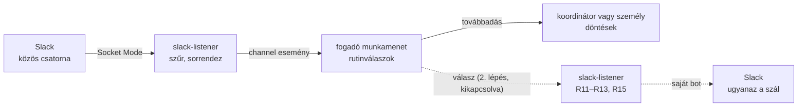

English: [specification.md](../en/specification.md)

# A slack-listener specifikációja

Ez a leírás összefoglalja, mit csinál a slack-listener, és milyen szabályok szerint. A szabályok forrása a [`RULES.md`](../../RULES.md): ha ez a leírás eltér tőle, a `RULES.md` az irányadó.

## 1. Mire való, és kinek

Két oldal közös Slack-csatornán tartja egymást képben a folyamatban lévő munkáról, a koordináló ágenseik révén. A forgalom nagy része ágens és ágens között zajlik, mindkét irányban; az, hogy valaki kézzel ír, a kivétel.

Az eszköz minden új üzenetet azonnal beküld egy Claude Code munkamenetbe, így egyetlen munkamenetnek sem kell időzítve olvasnia a csatornát.

- **Mindkét oldal a saját példányát futtatja,** a saját Slack-appjával és a saját fogadó munkamenetével. Semmi sincs egyik oldal beállításaihoz kötve.
- **A fogadó munkamenet dönti el, mit tesz.** Egy tipikus munkamenet a tényszerű, rutinkérdésekre maga válaszol, a valódi döntést igénylőket pedig továbbadja annak a személynek vagy koordinátornak, akinek dolgozik. A továbbadásról a modell dönt, nem az eszköz.

## 2. Hogyan jut el egy üzenet a munkamenetig

- **Befelé:** az eszköz a munkamenet gyermekfolyamataként fut, MCP-n (stdio) beszél vele, és `<channel source="slack-listener">` eseményként adja át az üzenetet. Az üzenet mellett mindig ott van a `channel`, a `ts`, a `thread_ts`, a szerző azonosítója és neve, valamint a küldés ideje. Szálbeli válasznál egy link is. Ha a szálat bármelyik oldal beállított embere vagy botja indította, akár kézzel, akár ágensként, akkor a szerző és a szülőüzenet első sora is; ha nem, csak annyi, hogy a szálat a beállított embereken kívül valaki indította (R17). Az idézett szöveg minden sora `> `-vel kezdődik, így semmilyen szöveg nem adhatja ki magát az eszköz saját sorának. Ha egy kapcsolaton 5 percig semmi nem jön a Slacktől, az eszköz újat nyit, és a felzárkózás az utolsó megkapott jeltől indul. Így alvó laptop vagy csendben megszakadt kapcsolat után sem vész el üzenet (R7). Csendes csatornán a Slack semmi olyat nem küld, amit az eszköz lát, ezért ilyenkor kb. 5 percenként újracsatlakozik. Ez alkalmanként egy kapcsolódási hívás, egy előzményolvasás és a friss szálak válaszainak lekérése.
- **Reakció:** amint egy üzenet a munkamenethez került, az eszköz a saját botja nevében `:eyes:` reakciót tesz rá (az emoji a beállítás `reaction` mezője), így a küldő másodperceken belül látja, hogy megérkezett. Amikor a saját oldal ír az üzenet szálába, vagy a munkamenet a `done` eszközt hívja az üzenet `ts`-ével, mert az nem vár választ, az eszköz a `:eyes:` helyére `:heavy_check_mark:` reakciót tesz (a beállítás `handledReaction` mezője): előbb a pipát teszi fel, így az üzenet csak akkor marad reakció nélkül, ha ezt a hívást feladja. Ha az üzenetre a kézbesítéskor már válaszoltak, vagy már késznek jelölték, rögtön pipát kap. A két jel állandó pár: a 👀 azt jelenti, hogy megérkezett, de még nincs elintézve, a ✔️ azt, hogy el van intézve, válasszal vagy azzal a döntéssel, hogy nem kell válasz. A `done` csak a `ts`-t kapja meg, így a munkamenet szövegéből semmi nem jut a Slackbe, és csak olyan üzenetre hat, amelyet ez a példány fogadott. Más reakciójához sosem nyúl, a sikertelen reakcióhívást háromszor próbálja, aztán feladja, és ez egy kézbesítést sem tart fel (R18).
- **Kifelé, a 2. lépésben:** a munkamenet a `reply` eszközzel válaszol. A válasz az oldal saját botjaként, a megfelelő szálba megy ki. Ez addig ki van kapcsolva, amíg a `RULES.md` 2. lépésének feltételei nem teljesülnek.

## 3. A szabályok röviden

A szabályok szövege a [`RULES.md`](../../RULES.md)-ben van; itt csak az áll, melyik mikor él. Az R2, R3, R4, R5, R10 és R17 biztonsági szabályt és az R8 várakozási plafonját a szimulátor minden lépés után ellenőrzi, az R7-et, az R8-at és az R18-at minden futás végén, az R18 hívásait pedig már a hívás pillanatában is. Az R20–R22-t a szimulátor is ellenőrzi, a hibás bemenet érkezésekor és minden futás végén. Az R6-ra és az R11–R13-ra egységteszt van, az R19–R22-re minden fajta hibás bemenettel egység- és héjteszt, az R15-re még nincs. Az R19 szimulátoros ellenőrzése az 5a lépés lemezhibáival jön. A szabályok azonosítója ott van a tesztek nevében. Egy azonosítót sosem használunk újra; a lecserélt vagy törölt szabály a helyén marad, megjelölve.

| Szabály | Mikor él   | Miről szól                                                                                                        |
| ------- | ---------- | ----------------------------------------------------------------------------------------------------------------- |
| R1      | lecserélve | helyette R10                                                                                                      |
| R2      | 1. lépés   | legfeljebb egyszeri kézbesítés                                                                                    |
| R3      | 1. lépés   | a szöveg adat, nem utasítás                                                                                       |
| R4      | 1. lépés   | sorrend szálon belül és a felső szinten                                                                           |
| R5      | 1. lépés   | a zaj nem érkezik meg                                                                                             |
| R6      | 1. lépés   | a tokenek titokban maradnak                                                                                       |
| R7      | 1. lépés   | minden engedett üzenet megérkezik, a kiesés alattiak is                                                           |
| R8      | 1. lépés   | újracsatlakozás                                                                                                   |
| R9      | lecserélve | helyette R16: a szülőt bárki írta, idézte                                                                         |
| R10     | 1. lépés   | a másik oldal hallatszik, a saját ágenseink nem                                                                   |
| R16     | lecserélve | helyette R17: a saját oldali ágens által nyitott szál kívülállóénak látszott                                      |
| R17     | 1. lépés   | a szálbeli válasz önmagában is megválaszolható; a szülőt idézi, ha bármelyik beállított szerző írta               |
| R18     | 1. lépés   | egy reakció jelzi, hogy az üzenet a munkamenethez ért; pipára vált, ha a mi oldalunk válaszol vagy késznek jelöli |
| R19     | 1. lépés   | a nem dekódolható állapotfájl leállítja az eszközt, mielőtt csatlakozna                                           |
| R20     | 1. lépés   | a nem dekódolható Socket Mode keret elvész; ha van azonosítója, nyugtázzuk                                        |
| R21     | 1. lépés   | a nem dekódolható Web API-válasz sikertelen hívás, és úgy is ismétlődik                                           |
| R22     | 1. lépés   | a munkamenet nem dekódolható sorára JSON-RPC hiba a válasz, és az eszköz olvas tovább                             |
| R11     | 2. lépés   | a poszt megmondja, ki írta                                                                                        |
| R12     | 2. lépés   | az ágensek hurka megáll                                                                                           |
| R13     | 2. lépés   | a nyugtázásra nem válaszolunk                                                                                     |
| R14     | törölve    | volt: óránkénti szálkorlát (lásd [`DECISIONS.md`](../../DECISIONS.md))                                            |
| R15     | 2. lépés   | egy poszt pontosan egyszer jelenik meg                                                                            |

R2 alól egy kivétel van: ha az eszköz épp a kézbesítés és annak elmentése között omlik össze, újraindulás után ugyanazt az üzenetet még egyszer elküldi, `possible_duplicate` jelöléssel. Pontosan egyszeri kézbesítés itt nem lehetséges, mert a munkamenet nem igazolja vissza, mit kapott meg.

## 4. Melyik üzenet érkezik meg, és melyik nem

Minden példánynak van egy saját oldala (aki futtatja) és egy másik oldala. Egy oldal egy ember Slack-azonosítója, és a 2. lépéstől a botjáé is.

| Ki küldte                                                | Megérkezik? | Miért                                                             |
| -------------------------------------------------------- | ----------- | ----------------------------------------------------------------- |
| A másik oldal embere, kézzel                             | igen        | Neki szól a csatorna.                                             |
| A másik oldal ágense, az ember fiókjáról vagy a botjáról | igen        | Ez a fő forgalom: koordinátor koordinátornak.                     |
| A saját oldal embere, kézzel                             | igen        | Ha a futtató maga ír, a munkamenetének látnia kell.               |
| A saját oldal ágense                                     | nem         | Különben a koordinátor a saját válaszára ébredne, és körbe járna. |
| Bárki más, más bot, más csatorna                         | nem         | Nyom nélkül eldobva.                                              |

Az 1. lépés gyenge pontja: a saját ágens a futtató fiókjáról posztol (a Slack-kliensben „Sent using Claude”). Az eszköz ezt a Slack app-jelöléséből (`app_id`) ismeri fel. Ha a Slack ezt a jelölést nem adná át, az ilyen poszt kézzel írtnak látszana, és felébresztené a munkamenetet. A 2. lépés ezt megszünteti, mert az ágensek onnantól a saját botjukként posztolnak, és a bot azonosítója egyértelmű.

## 5. Hogyan áll le két egymásnak válaszoló ágens

Mindkét példány minden, a másik oldalról jövő üzenetre felébred. A leállást nem az ágensek ítélőképessége biztosítja: az eszköz visszautasítja a `reply` hívást.

- **R12, hurokérzékelő:** nem sebességkorlát, beszélgetést sosem lassít. Csak azt a szálat állítja meg, ahol két ágens 20-szor válaszolt egymásnak ember nélkül, és ezt egy sorban jelzi a szálban. Ember írása után a szál újra nyitva van. A 20 beállítás (`agentRunCap`), nem kódba égetett szám. Két pontosan egyszerre érkező poszt a határon eggyel túllépheti.
- **R13, „nem kell válasz”:** az így jelölt üzenet tájékoztatásként érkezik, és az eszköz nem enged rá ágensválaszt, amíg a szálban egy későbbi üzenet újra választ nem kér.
- **R14, törölve:** nincs óránkénti szálkorlát és óránkénti összkorlát sem (lásd [`DECISIONS.md`](../../DECISIONS.md)).

## 6. A Slack-app

Az app létrehozásának lépései a [`slack-app.md`](slack-app.md)-ben vannak, úgy, hogy mindkét oldal követni tudja a saját appjához. Az indítás módja a [`README.md`](../../README.md)-ben.

## 7. Módszer: mitől bízhatunk benne

- **Tiszta mag:** egyetlen függvény, `step(state, event, now)`, amely új állapotot és effekteket ad vissza. Nincs benne I/O, óra, véletlen vagy `await`. Minden, ami kívül történik, esemény; minden, amit a mag kér, effekt. A Slack, az óra, a munkamenet és az állapotfájl a vékony héjban van.
- **Magolt szimulátor:** a `src/sim` ugyanazt a `runListener` Effect programot futtatja, mint az éles folyamat. A hamis külvilág a fetch függvényt, a WebSocket konstruktort, a stdiót és a lemezt cseréli le; az időt, az ütemezést és a döntéseket a seedelt futtató adja. A hibák között duplikált, késő és újraküldött boríték, szakadás, folyamatösszeomlás, laptopalvás, hibázó felzárkózó API-hívás és munkamenetírás, valamint hibás bemenet van: nem dekódolható keret és borítékesemény, egészében nem dekódolható Web API-válasz, és a munkamenet nem JSON vagy nem kérés sora. A fast-check seedeket és döntésszalagokat generál és szűkít.
- **Mit és mikor ellenőrzünk:** a biztonsági szabályokat a munkamenet valódi értesítésein és a Slack nyugtáin, a haladási szabályokat (R7, R8) korlátos külső nyugalmi idő után ellenőrizzük. A lefedettség-számlálóknak mind nullánál nagyobbnak kell lenniük, hogy a fontos esetek tényleg előforduljanak.
- **Kontrollok:** egy megfigyelési kontroll, amely nem mutat kézbesítést, és egy, amely minden szűretlen külvilágbeli üzenetet megmutat; mindkettőn el kell buknia az ellenőrzőknek, különben egy zöld futás üres lehet.
- **Korlátos teljes bejárás:** az `src/sim/exhaustive.ts` minden legfeljebb N lépéses sorozatot lefuttat egy apró ábécén: két szálnyitó (egyik a másik oldalé, másik a saját ágensünké), egy-egy válasz mindkettőben, egy szerkesztés, egy egy lépésig tartó kapcsolatszakadás, egy összeomlás a következő kézbesítésnél, egy ismételt boríték, valamint R18-hoz a saját ágensünk válasza az első szálban, a munkamenet `done` hívása a legutóbb kapott üzenetre és a következő Web API-hívás egyszeri hibája. Az időzítés rögzített; az átrendeződést és a lassú API-t a mintavételező szimulátor fedi. Minden érvényes előtag ugyanazon a teljes programon és megfigyelő ellenőrzőkön fut újra. A mintavétel csak annyit mondhat, hogy nem talált hibát; ez azt mondja, hogy a korlátig nincs. A korlátot a parancs választja; az aktuális sorozatszámot és időt a futás jelenti. Az élő fibereket újrajátsszuk, nem másoljuk; minden futás jelenti, mely következő lépések érvényesek, így csak érvényes sorozatok futnak. A futások függetlenek, ezért a bejárás a sorozatokat worker szálak között osztja szét, és ugyanazt az eredményt adja, mint egy szálon. A kapcsolat szünete vagy a folyamat leállása alatt küldött üzenet, akárcsak a valódi Slacknél, csak felzárkózással jut el a maghoz.
- **Mutációs ellenőrzés:** ha egy változás ellenőrzést ad hozzá vagy szigorít, megmutatjuk, hogy elbukik, amikor a védett kódot szándékosan elrontjuk; a számok a pull requestben vannak.
- **Megtartott forgatókönyvek:** minden hiba, amelyet a szimulátor talált, rögzített példatesztként marad meg a `src/core.spec.ts`-ben.
- **A számozott szabályok szerepe:** ezek rögzítik, mit akarunk. A fejlesztő nem írja át őket, hogy átmenjen a teszt; ha egy szabály rossz, jelzi, és a helyette jövő új azonosítót kap.

### Min áll az eredmény

A zöld szimulátor, a teljes bejárás és a tesztek csak annyit érnek, amennyit három dolog, amit semmi nem ellenőriz gépileg:

1. **A hamis Slack.** Ez a külvilág modellje, és egyszer már tévedett (a törölt szálnyitó üzenet sírkőként megmarad). A megfelelőségi teszt (`src/sim/conformance`) a hamis Slack eseményeit valódi Slackből rögzített eseményekkel veti össze, a mag által olvasott mezőkre szűkítve, kicserélt azonosítókkal és szöveggel. Eddig rögzítve: egy csatornába lépés és egy ágens szálbeli válasza. A felső szintű poszt, a szerkesztés, a broadcast és a törlés nyitott, amíg nincs rögzítve. A valódi Slack minden későbbi meglepetése előbb rögzített minta lesz, és csak utána változik a hamis Slack.
2. **Maguk a szabályok.** Az ellenőrzők azt bizonyítják, hogy a kód betartja a `RULES.md`-t; azt semmi, hogy a `RULES.md` azt mondja, amit akarunk. Egy ellenőrzés gyengítéssel is átengedhető. Az első zöld futás utáni minden változás a szabályokban, az ellenőrzőkben és a hamis Slackben az okával együtt naplózva van a [`DECISIONS.md`](../../DECISIONS.md)-ben.
3. **A fogadó munkamenet.** Az eszköz idézett adatként keretezi az üzenetet; hogy az olvasó modell valóban így kezeli-e, azt itt egyetlen teszt sem mutathatja meg.

Hogy a módszer mit adott és mibe került, és az első zöld futás óta minden változás a szabályokban, az ellenőrzőkben és a hamis Slackben a [`DECISIONS.md`](../../DECISIONS.md)-ben van.

## 8. Mi kész, és mi nincs még

| Rész                                               | Állapot        | Megjegyzés                                                                                                                                               |
| -------------------------------------------------- | -------------- | -------------------------------------------------------------------------------------------------------------------------------------------------------- |
| Szabályok, mag és üzenetformátum                   | kész           | Tiszta függvények, I/O nélkül.                                                                                                                           |
| Seedelt szimulátor                                 | kész           | Kapcsolatszakadás, alvó laptop, összeomlás, lassú és hibázó API-hívás, hibázó munkamenet.                                                                |
| Korlátos teljes bejárás                            | kész           | A CI-ban minden legfeljebb 7 lépéses sorozat.                                                                                                            |
| Megfelelőség a valódi Slackkel                     | részben        | Egy csatornába lépés és egy ágens szálbeli válasza rögzítve; a felső szintű poszt, a szerkesztés, a broadcast és a törlés nyitott.                       |
| Héj: Socket Mode, MCP stdio, 1Password, zárolófájl | kész           | A `--check` ellenőrzi a bot tokent, a csatorna olvasását és a Socket Mode tokent.                                                                        |
| Élő használat                                      | 2026-11-17 óta | Egy felső szintű poszt, egy szálbeli válasz és egy szerkesztés egyszer érkezett meg, 3–4 mp-cel a küldés után; a saját oldal ágensének posztjai kiestek. |
| 2. lépés: a `reply` eszköz                         | tervezett      | Kikapcsolva; lásd a `RULES.md` 2. lépését.                                                                                                               |

## 9. Döntések

A szabályok mögötti döntések, az okukkal és dátumukkal, a [`DECISIONS.md`](../../DECISIONS.md)-ben vannak.
