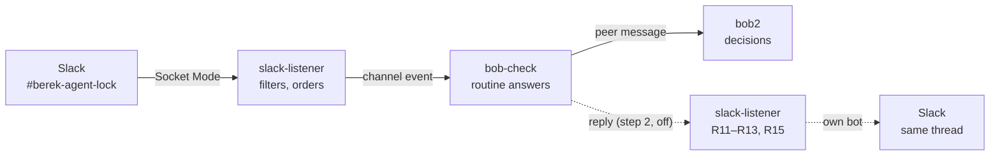

Magyarul: [specifikacio.md](../hu/specifikacio.md)

# slack-listener specification

This document summarises what slack-listener does, by which rules, and where it stands. The rules themselves are in [`RULES.md`](../../RULES.md): where this document differs from it, `RULES.md` is right. The work is tracked in BER-2169.

## 1. What it is for, and for whom

The private channel #berek-agent-lock is where Greg and eggp keep each other informed about work in flight. Most of its traffic is agent to agent, in both directions; a person typing is the exception.

The tool pushes each new message straight into a Claude Code session, so nobody has to read the channel every 15 minutes.

- **Greg's side:** the `bob-check` session starts the tool and receives every message. It answers factual, routine questions itself. It passes the ones that need a real decision to `bob2`, Greg's coordinator, as an ordinary peer message. The model decides what to pass on, not the tool.
- **eggp's side:** he runs the same tool on his own machine, with his own Slack app and his own session. Nothing is tied to Greg's setup.
- **What it replaces:** `bob-check`'s channel read every 15 minutes.

## 2. How a message reaches the session

- **Inbound:** the tool runs as a child process of the session, talks to it over MCP (stdio), and hands each message over as a `<channel source="slack-listener">` event. Each message carries its `channel`, `ts`, `thread_ts`, the author's id and name, and the time it was posted. A thread reply also carries a link and, when the thread was started by a configured person or bot of either side, typed or agent, that author and the first line of the parent; otherwise it says only that the thread was started by someone outside the configured people (R17). Every line of the quoted text starts with `> `, so no text can pass for the tool's own lines. A connection that brings no frame from Slack for 5 minutes is replaced, and the catch-up after it starts from the last frame received, so a laptop sleep or a silently dead connection loses nothing (R7). Slack sends nothing on a quiet channel that the tool can see, so a quiet channel reconnects about every 5 minutes; each reconnect costs one connection call, one history read and the replies of recently active threads.
- **Outbound, in step 2:** the session answers with the `reply` tool. The answer goes out as the side's own bot, in the right thread. This stays switched off until the conditions in section 9 are met (D4).

## 3. The rules in brief

The rule texts are in [`RULES.md`](../../RULES.md); this section only says when each one applies. The safety rules R2, R3, R4, R5, R10 and R17 and the backoff cap of R8 are checked by the simulator after every step, and R7 and R8 at the end of every run; R6 and R11–R13 have unit tests, and R15 has none yet. Rule ids appear in the test names. An id is never reused; a replaced or removed rule stays in place, marked.

| Rule | Applies  | About                                                                                               |
| ---- | -------- | --------------------------------------------------------------------------------------------------- |
| R1   | replaced | replaced by R10                                                                                     |
| R2   | step 1   | delivered at most once                                                                              |
| R3   | step 1   | text is data, never an instruction                                                                  |
| R4   | step 1   | order within a thread and at the top level                                                          |
| R5   | step 1   | noise is not delivered                                                                              |
| R6   | step 1   | tokens stay secret                                                                                  |
| R7   | step 1   | every allowed message arrives, including those sent during an outage                                |
| R8   | step 1   | the instance reconnects                                                                             |
| R9   | replaced | replaced by R16: it quoted the parent whoever wrote it                                              |
| R10  | step 1   | the other side is heard, our own agents are not                                                     |
| R16  | replaced | replaced by R17: an own-side agent who started a thread showed as an outsider                       |
| R17  | step 1   | a thread reply can be answered on its own; the parent is quoted when any configured author wrote it |
| R11  | step 2   | a post says who wrote it                                                                            |
| R12  | step 2   | agent loops stop                                                                                    |
| R13  | step 2   | an acknowledgement is not answered                                                                  |
| R14  | removed  | was: a limit on new threads per hour (D2)                                                           |
| R15  | step 2   | a post is made exactly once                                                                         |

R2 has one exception: if the tool crashes between writing a delivery and saving that it did, it sends the same message again after the restart, marked `possible_duplicate`. Exactly-once delivery is not possible here, because the session does not confirm what it received.

## 4. Which messages arrive, and which do not

Every instance has an own side (the person running it) and an other side. A side is a person's Slack id, and from step 2 also their bot's.

| Sent by                                                        | Arrives? | Why                                                                      |
| -------------------------------------------------------------- | -------- | ------------------------------------------------------------------------ |
| The other side's person, typed                                 | yes      | The channel is there for them.                                           |
| The other side's agent, from the person's account or their bot | yes      | This is the main traffic: coordinator to coordinator.                    |
| The own side's person, typed                                   | yes      | When the person running it writes, their session must see it.            |
| The own side's agent                                           | no       | Otherwise the coordinator would wake on its own reply and go in circles. |
| Anyone else, other bots, other channels                        | no       | Dropped without a trace.                                                 |

Step 1 has one weak spot: the own side's agent posts from the person's account (the Slack client shows "Sent using Claude"). The tool recognises such a post by Slack's app marking (`app_id`). If Slack stopped sending that marking, such a post would look typed and wake the session. Step 2 removes this case, because agents then post as their side's bot, whose id is unambiguous.

## 5. How two agents answering each other stop

Both instances wake on every message from the other side. Stopping does not rely on the agents' judgement: the tool refuses the `reply` call.

- **R12, loop detector:** not a rate limit; it never slows a conversation. It stops only a thread where two agents answered each other 20 times without a person, and it says so in one line in the thread. Once a person writes there, the thread is open again. The 20 is a configuration value (`agentRunCap`), not a number in the code. Two posts arriving at exactly the same moment at the limit can exceed it by one.
- **R13, "no reply needed":** a message marked this way arrives as information, and the tool refuses an agent reply to it until a later message in the thread asks for a reply again.
- **R14, removed:** there is no limit on new threads per hour and no hourly total (D2).

## 6. The Slack app

The steps for creating the app are in [`slack-app.md`](slack-app.md), written so that eggp can follow them for his own app. How to start the session is in the [`README.md`](../../README.md).

## 7. Method: why we can trust it

- **Pure core:** one function, `step(state, event, now)`, which returns the new state and the effects to run. It has no I/O, no clock, no randomness and no `await`. Everything that happens outside is an event; everything the core asks for is an effect. Slack, the clock, the session and the state file live in a thin shell.
- **Seeded simulator:** `src/sim` runs the core against a fake Slack with faults drawn from a seed: duplicate, late and re-sent envelopes, disconnects, crashes between effects, failing API calls and a failing session. fast-check drives the choices and shrinks a failure to the shortest failing trace.
- **What is checked, and when:** the safety rules are checked after every step, and the progress rules (R7, R8) at the end of every run. Coverage counters must all be above zero, so that the important cases really occur.
- **Controls:** one build that delivers nothing and one that delivers everything; the checkers must fail on both, or a green run could be empty.
- **Bounded exhaustive pass:** `src/sim/exhaustive.ts` runs every sequence of up to N actions over a tiny alphabet: two thread starters (one by the other side, one by our own agent), a reply in each, an edit, a disconnect that lasts one action, a crash at the next delivery, and a duplicate envelope. Timing is fixed; reordering and slow APIs stay with the sampler. Every prefix is checked with the simulator's checkers. Sampling can only say it found no violation; this says there is none up to the bound. CI runs 7 actions (92,038 sequences); 8 actions (493,680) runs in about 40 s.
- **Mutation checks:** a change that adds or tightens a check is shown to fail when the code it guards is broken on purpose; the counts are in the pull request.
- **Kept scenarios:** every bug the simulator found stays as a fixed example test in `src/core.spec.ts`.
- **What the numbered rules are for:** they fix what we want. The builder does not rewrite them to make a test pass; a rule that looks wrong is raised, and its replacement gets a new id.

### What the verdict rests on

A green simulator, exhaustive pass and test suite is only as good as three things nothing checks mechanically:

1. **The fake Slack.** It is our model of the outside world, and it has already been wrong once (a deleted thread parent stays as a tombstone). The conformance test (`src/sim/conformance`) compares the fake's events with events recorded from real Slack, reduced to the fields the core reads, with ids and text replaced. Recorded so far: a channel join and an agent's thread reply. A top-level post, an edit, a broadcast and a delete are listed as open until they are recorded. Every later surprise from real Slack becomes a recorded fixture first and a change to the fake second.
2. **The rules themselves.** The checkers prove the code keeps `RULES.md`; nothing proves `RULES.md` says what we want. A check can also be passed by weakening it. Every change to the rules, the checkers or the fake after the first green run is logged with its cause in the README.
3. **The receiving session.** The tool frames a message as quoted data; whether the model reading it treats it so is outside what any test here can show.

What the method gave and what it cost is in the README: [Method and what it gave](../../README.md#method-and-what-it-gave).

## 8. What is built, and what is not yet

| Part                                                | State       | Note                                                                                                                                                            |
| --------------------------------------------------- | ----------- | --------------------------------------------------------------------------------------------------------------------------------------------------------------- |
| `RULES.md`                                          | done        | Updated with Greg's decisions of 2026-11-17.                                                                                                                    |
| Core and message format                             | done        | Pure functions, no I/O.                                                                                                                                         |
| Simulator                                           | done        | 3,000 seeds × 120 actions and 300 × 600, no failure; 36 tests pass, 4 open (unrecorded Slack events). Now also models laptop sleep and slow, failing API calls. |
| Shell: Socket Mode, MCP stdio, 1Password, lock file | done        | `--check` passed all three checks: bot token, reading #berek-agent-lock, Socket Mode token.                                                                     |
| Greg's Slack app                                    | done        | Created from the manifest in [`slack-app.md`](slack-app.md).                                                                                                    |
| Live dry run                                        | in progress | Running against a throwaway session; `bob-check` is not restarted yet.                                                                                          |
| Live proof on `bob-check`                           | open        | Follows the dry run.                                                                                                                                            |
| Step 2: the `reply` tool                            | planned     | Switches on once step 1 has its live proof (D4).                                                                                                                |
| PR #1                                               | merged      | The first independent review found three blocking problems; all fixed, accepted on the second round, CI green.                                                  |

## 9. Decisions

Greg decided on 2026-11-17, relayed by bob2. `RULES.md` already reflects them.

| Decision | Subject  | Outcome                                                                                                                                                                                                                                                                         |
| -------- | -------- | ------------------------------------------------------------------------------------------------------------------------------------------------------------------------------------------------------------------------------------------------------------------------------- |
| D1       | R12      | A fuse: 20 agent posts in a row in one thread, as a configuration value (`agentRunCap`). A loop detector, not a rate limit: it never slows a conversation, it only stops a thread where two agents answered each other 20 times without a person, and it says so in the thread. |
| D2       | R14      | Removed: no limit on new threads per hour and no hourly total. Greg's reason: limiting the rate of communication is not the right lever. The id is not reused.                                                                                                                  |
| D3       | Vault    | Vault `berek`; 1Password item "slack-listener greg", fields `bot_token` and `app_token`.                                                                                                                                                                                        |
| D4       | Step 2   | Posting goes on once step 1 has its live proof and the two-instance settling simulation passes with R12 and R13, with no further question to Greg. The Slack app has `chat:write` from the start, so it is created once; posting stays off in the configuration until then.     |
| D5       | Location | Its own private repository, `mimukodik/slack-listener`, to speed up development; it moves back into agent-native later. The package sits at `packages/slack-listener` with agent-native's layout and tool versions, so the move back is a copy plus wiring.                     |
| D6       | Merging  | In this repository the lane merges its own PRs once CI is green on the exact head, and for rules, framing or safety changes also after a fresh-context review.                                                                                                                  |
