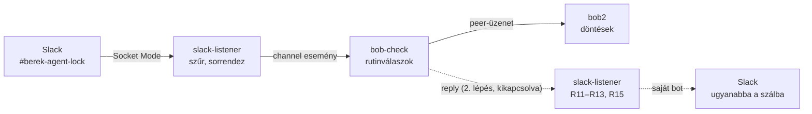

English: [specification.md](../en/specification.md)

# A slack-listener specifikációja

Ez a leírás összefoglalja, mit csinál a slack-listener, milyen szabályok szerint, és hol tart. A szabályok forrása a [`RULES.md`](../../RULES.md): ha ez a leírás eltér tőle, a `RULES.md` az irányadó. A munka jegye a BER-2169.

## 1. Mire való, és kinek

A #berek-agent-lock privát csatorna Greg és eggp közös felülete a folyamatban lévő munkáról. A forgalom nagy része ágens és ágens között zajlik, mindkét irányban; az, hogy valaki kézzel ír, a kivétel.

Az eszköz minden új üzenetet azonnal beküld egy Claude Code munkamenetbe, így senkinek nem kell 15 percenként olvasnia a csatornát.

- **Greg oldala:** a `bob-check` munkamenet indítja az eszközt, és ő kap meg minden üzenetet. A tényszerű, rutinkérdésekre maga válaszol. A valódi döntést igénylőket rendes peer-üzenetként továbbadja `bob2`-nek, Greg koordinátorának. A továbbadásról a modell dönt, nem az eszköz.
- **eggp oldala:** ugyanezt az eszközt futtatja a saját gépén, a saját Slack-appjával és a saját munkamenetével. Semmi sincs Greg beállításaihoz kötve.
- **Amit kivált:** a `bob-check` eddigi, 15 percenkénti csatornaolvasását.

## 2. Hogyan jut el egy üzenet a munkamenetig

- **Befelé:** az eszköz a munkamenet gyermekfolyamataként fut, MCP-n (stdio) beszél vele, és `<channel source="slack-listener">` eseményként adja át az üzenetet. Az üzenet mellett mindig ott van a `channel`, a `ts`, a `thread_ts`, a szerző azonosítója és neve, valamint a küldés ideje. Szálbeli válasznál egy link is. Ha a szálat bármelyik oldal beállított embere vagy botja indította, akár kézzel, akár ágensként, akkor a szerző és a szülőüzenet első sora is; ha nem, csak annyi, hogy a szálat a beállított embereken kívül valaki indította (R17). Az idézett szöveg minden sora `> `-vel kezdődik, így semmilyen szöveg nem adhatja ki magát az eszköz saját sorának. Ha egy kapcsolaton 5 percig semmi nem jön a Slacktől, az eszköz újat nyit, és a felzárkózás az utolsó megkapott jeltől indul. Így alvó laptop vagy csendben megszakadt kapcsolat után sem vész el üzenet (R7). Csendes csatornán a Slack semmi olyat nem küld, amit az eszköz lát, ezért ilyenkor kb. 5 percenként újracsatlakozik. Ez alkalmanként egy kapcsolódási hívás, egy előzményolvasás és a friss szálak válaszainak lekérése.
- **Kifelé, a 2. lépésben:** a munkamenet a `reply` eszközzel válaszol. A válasz az oldal saját botjaként, a megfelelő szálba megy ki. Ez addig ki van kapcsolva, amíg a 9. részben leírt feltételek nem teljesülnek (D4).

## 3. A szabályok röviden

A szabályok szövege a [`RULES.md`](../../RULES.md)-ben van; itt csak az áll, melyik mikor él. Az R2, R3, R4, R5, R10 és R17 biztonsági szabályt és az R8 várakozási plafonját a szimulátor minden lépés után ellenőrzi, az R7-et és az R8-at minden futás végén. Az R6-ra és az R11–R13-ra egységteszt van, az R15-re még nincs. A szabályok azonosítója ott van a tesztek nevében. Egy azonosítót sosem használunk újra; a lecserélt vagy törölt szabály a helyén marad, megjelölve.

| Szabály | Mikor él   | Miről szól                                                                                          |
| ------- | ---------- | --------------------------------------------------------------------------------------------------- |
| R1      | lecserélve | helyette R10                                                                                        |
| R2      | 1. lépés   | legfeljebb egyszeri kézbesítés                                                                      |
| R3      | 1. lépés   | a szöveg adat, nem utasítás                                                                         |
| R4      | 1. lépés   | sorrend szálon belül és a felső szinten                                                             |
| R5      | 1. lépés   | a zaj nem érkezik meg                                                                               |
| R6      | 1. lépés   | a tokenek titokban maradnak                                                                         |
| R7      | 1. lépés   | minden engedett üzenet megérkezik, a kiesés alattiak is                                             |
| R8      | 1. lépés   | újracsatlakozás                                                                                     |
| R9      | lecserélve | helyette R16: a szülőt bárki írta, idézte                                                           |
| R10     | 1. lépés   | a másik oldal hallatszik, a saját ágenseink nem                                                     |
| R16     | lecserélve | helyette R17: a saját oldali ágens által nyitott szál kívülállóénak látszott                        |
| R17     | 1. lépés   | a szálbeli válasz önmagában is megválaszolható; a szülőt idézi, ha bármelyik beállított szerző írta |
| R11     | 2. lépés   | a poszt megmondja, ki írta                                                                          |
| R12     | 2. lépés   | az ágensek hurka megáll                                                                             |
| R13     | 2. lépés   | a nyugtázásra nem válaszolunk                                                                       |
| R14     | törölve    | volt: óránkénti szálkorlát (D2)                                                                     |
| R15     | 2. lépés   | egy poszt pontosan egyszer jelenik meg                                                              |

R2 alól egy kivétel van: ha az eszköz épp a kézbesítés és annak elmentése között omlik össze, újraindulás után ugyanazt az üzenetet még egyszer elküldi, `possible_duplicate` jelöléssel. Pontosan egyszeri kézbesítés itt nem lehetséges, mert a munkamenet nem igazolja vissza, mit kapott meg.

## 4. Melyik üzenet érkezik meg, és melyik nem

Minden példánynak van egy saját oldala (aki futtatja) és egy másik oldala. Egy oldal egy ember Slack-azonosítója, és a 2. lépéstől a botjáé is.

| Ki küldte                                                | Megérkezik? | Miért                                                             |
| -------------------------------------------------------- | ----------- | ----------------------------------------------------------------- |
| A másik oldal embere, kézzel                             | igen        | Neki szól a csatorna.                                             |
| A másik oldal ágense, az ember fiókjáról vagy a botjáról | igen        | Ez a fő forgalom: koordinátor koordinátornak.                     |
| A saját oldal embere, kézzel                             | igen        | Ha a futtató maga ír, a munkamenetének látnia kell.               |
| A saját oldal ágense                                     | nem         | Különben a koordinátor a saját válaszára ébredne, és körbe járna. |
| Bárki más, más bot, más csatorna                         | nem         | Nyom nélkül eldobva.                                              |

Az 1. lépés gyenge pontja: a saját ágens a futtató fiókjáról posztol (a Slack-kliensben „Sent using Claude”). Az eszköz ezt a Slack app-jelöléséből (`app_id`) ismeri fel. Ha a Slack ezt a jelölést nem adná át, az ilyen poszt kézzel írtnak látszana, és felébresztené a munkamenetet. A 2. lépés ezt megszünteti, mert az ágensek onnantól a saját botjukként posztolnak, és a bot azonosítója egyértelmű.

## 5. Hogyan áll le két egymásnak válaszoló ágens

Mindkét példány minden, a másik oldalról jövő üzenetre felébred. A leállást nem az ágensek ítélőképessége biztosítja: az eszköz visszautasítja a `reply` hívást.

- **R12, hurokérzékelő:** nem sebességkorlát, beszélgetést sosem lassít. Csak azt a szálat állítja meg, ahol két ágens 20-szor válaszolt egymásnak ember nélkül, és ezt egy sorban jelzi a szálban. Ember írása után a szál újra nyitva van. A 20 beállítás (`agentRunCap`), nem kódba égetett szám. Két pontosan egyszerre érkező poszt a határon eggyel túllépheti.
- **R13, „nem kell válasz”:** az így jelölt üzenet tájékoztatásként érkezik, és az eszköz nem enged rá ágensválaszt, amíg a szálban egy későbbi üzenet újra választ nem kér.
- **R14, törölve:** nincs óránkénti szálkorlát és óránkénti összkorlát sem (D2).

## 6. A Slack-app

Az app létrehozásának lépései a [`slack-app.md`](slack-app.md)-ben vannak, úgy, hogy eggp is követni tudja a saját appjához. Az indítás módja a [`README.md`](../../README.md)-ben.

## 7. Módszer: mitől bízhatunk benne

- **Tiszta mag:** egyetlen függvény, `step(state, event, now)`, amely új állapotot és effekteket ad vissza. Nincs benne I/O, óra, véletlen vagy `await`. Minden, ami kívül történik, esemény; minden, amit a mag kér, effekt. A Slack, az óra, a munkamenet és az állapotfájl a vékony héjban van.
- **Magolt szimulátor:** a `src/sim` a magot egy hamis Slack ellen futtatja, beállított magból (seed) származó hibákkal: duplikált, késő és újraküldött esemény, szakadás, összeomlás két effekt között, hibázó API-hívás és munkamenet. A döntéseket a fast-check hajtja, és hiba esetén a legrövidebb hibás sorozatra szűkít.
- **Mit és mikor ellenőrzünk:** a biztonsági szabályokat minden lépés után, a haladási szabályokat (R7, R8) minden futás végén ellenőrizzük. A lefedettség-számlálóknak mind nullánál nagyobbnak kell lenniük, hogy a fontos esetek tényleg előforduljanak.
- **Kontrollok:** egy változat, amely semmit sem kézbesít, és egy, amely mindent; mindkettőn el kell buknia az ellenőrzőknek, különben egy zöld futás üres lehet.
- **Korlátos teljes bejárás:** az `src/sim/exhaustive.ts` minden legfeljebb N lépéses sorozatot lefuttat egy apró ábécén: két szálnyitó (egyik a másik oldalé, másik a saját ágensünké), egy-egy válasz mindkettőben, egy szerkesztés, egy egy lépésig tartó kapcsolatszakadás, egy összeomlás a következő kézbesítésnél és egy ismételt boríték. Az időzítés rögzített; az átrendeződést és a lassú API-t a mintavételező szimulátor fedi. Minden előtagot a szimulátor ellenőrzői vizsgálnak. A mintavétel csak annyit mondhat, hogy nem talált hibát; ez azt mondja, hogy a korlátig nincs. A CI 7 lépésig fut (92 038 sorozat); 8 lépésig (493 680) kb. 40 mp.
- **Mutációs ellenőrzés:** ha egy változás ellenőrzést ad hozzá vagy szigorít, megmutatjuk, hogy elbukik, amikor a védett kódot szándékosan elrontjuk; a számok a pull requestben vannak.
- **Megtartott forgatókönyvek:** minden hiba, amelyet a szimulátor talált, rögzített példatesztként marad meg a `src/core.spec.ts`-ben.
- **A számozott szabályok szerepe:** ezek rögzítik, mit akarunk. A fejlesztő nem írja át őket, hogy átmenjen a teszt; ha egy szabály rossz, jelzi, és a helyette jövő új azonosítót kap.

### Min áll az eredmény

A zöld szimulátor, a teljes bejárás és a tesztek csak annyit érnek, amennyit három dolog, amit semmi nem ellenőriz gépileg:

1. **A hamis Slack.** Ez a külvilág modellje, és egyszer már tévedett (a törölt szálnyitó üzenet sírkőként megmarad). A megfelelőségi teszt (`src/sim/conformance`) a hamis Slack eseményeit valódi Slackből rögzített eseményekkel veti össze, a mag által olvasott mezőkre szűkítve, kicserélt azonosítókkal és szöveggel. Eddig rögzítve: egy csatornába lépés és egy ágens szálbeli válasza. A felső szintű poszt, a szerkesztés, a broadcast és a törlés nyitott, amíg nincs rögzítve. A valódi Slack minden későbbi meglepetése előbb rögzített minta lesz, és csak utána változik a hamis Slack.
2. **Maguk a szabályok.** Az ellenőrzők azt bizonyítják, hogy a kód betartja a `RULES.md`-t; azt semmi, hogy a `RULES.md` azt mondja, amit akarunk. Egy ellenőrzés gyengítéssel is átengedhető. Az első zöld futás utáni minden változás a szabályokban, az ellenőrzőkben és a hamis Slackben az okával együtt naplózva van a README-ben.
3. **A fogadó munkamenet.** Az eszköz idézett adatként keretezi az üzenetet; hogy az olvasó modell valóban így kezeli-e, azt itt egyetlen teszt sem mutathatja meg.

Hogy a módszer mit adott és mibe került, az a README-ben van: [Method and what it gave](../../README.md#method-and-what-it-gave).

## 8. Mi kész, és mi nincs még

| Rész                                               | Állapot     | Megjegyzés                                                                                                                                                                       |
| -------------------------------------------------- | ----------- | -------------------------------------------------------------------------------------------------------------------------------------------------------------------------------- |
| `RULES.md`                                         | kész        | Greg 2026-11-17-i döntéseivel frissítve.                                                                                                                                         |
| Mag és üzenetformátum                              | kész        | Tiszta függvények, I/O nélkül.                                                                                                                                                   |
| Szimulátor                                         | kész        | 3000 seed × 120 lépés és 300 × 600, hiba nélkül; 36 teszt zöld, 4 nyitott (még nem rögzített Slack-esemény). Már az alvó laptopot és a lassú, hibázó API-hívásokat is modellezi. |
| Héj: Socket Mode, MCP stdio, 1Password, zárolófájl | kész        | A `--check` mindhárom ellenőrzése átment: bot token, a #berek-agent-lock olvasása, Socket Mode token.                                                                            |
| Greg Slack-appja                                   | kész        | Létrehozva, a [`slack-app.md`](slack-app.md) manifestje szerint.                                                                                                                 |
| Élő próba                                          | folyamatban | Egy eldobható munkamenet ellen fut; a `bob-check` még nincs újraindítva.                                                                                                         |
| Élő bizonyítás `bob-check`-en                      | nyitott     | A próba után következik.                                                                                                                                                         |
| 2. lépés: `reply` eszköz                           | tervezett   | Bekapcsol, amint az 1. lépés élő bizonyítása megvan (D4).                                                                                                                        |
| PR #1                                              | merge-elve  | Az első független review három blokkoló hibát talált; mind javítva, a második körben elfogadva, a CI zöld.                                                                       |

## 9. Döntések

Greg 2026-11-17-én döntött, bob2 közvetítésével. A `RULES.md` már ezeket tartalmazza.

| Döntés | Tárgy    | Mi lett                                                                                                                                                                                                                                                                                                 |
| ------ | -------- | ------------------------------------------------------------------------------------------------------------------------------------------------------------------------------------------------------------------------------------------------------------------------------------------------------- |
| D1     | R12      | Biztosíték: 20 egymást követő ágensüzenet egy szálban, beállításként (`agentRunCap`). Hurokérzékelő, nem sebességkorlát: beszélgetést sosem lassít, csak azt a szálat állítja meg, ahol két ágens 20-szor válaszolt egymásnak ember nélkül, és ezt a szálban jelzi.                                     |
| D2     | R14      | Törölve: nincs óránkénti szálkorlát és óránkénti összkorlát sem. Greg indoka: a kommunikáció sebességének korlátozása nem a jó eszköz. Az azonosítót nem használjuk újra.                                                                                                                               |
| D3     | Vault    | Vault: `berek`; 1Password-tétel: „slack-listener greg”, mezők: `bot_token`, `app_token`.                                                                                                                                                                                                                |
| D4     | 2. lépés | A posztolás bekapcsol, amint az 1. lépésnek megvan az élő bizonyítása, és a kétpéldányos leállási szimuláció R12-vel és R13-mal átmegy; Greget nem kérdezzük újra. A Slack-app kezdettől kapja a `chat:write` scope-ot, így egyszer kell létrehozni; a posztolás a beállításban addig ki van kapcsolva. |
| D5     | Helye    | Saját privát repó, `mimukodik/slack-listener`, a gyorsabb fejlesztésért; később visszakerül az agent-native-ba. A csomag a `packages/slack-listener` alatt van, az agent-native szerkezetével és eszközverzióival, így a visszaköltözés másolás és bekötés.                                             |
| D6     | Merge    | Ebben a repóban a lane maga merge-eli a PR-jait, ha a CI zöld a pontos headen; szabály-, keretezés- vagy biztonsági változásnál ezen felül friss kontextusú review után.                                                                                                                                |
